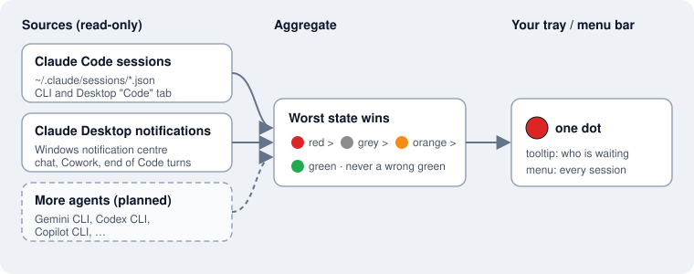

<p align="center">
  &nbsp;
  &nbsp;
  
</p>

<h1 align="center">AgentSemaphore</h1>

<p align="center">
  <b>One dot next to your clock that tells you which AI agent needs you.</b><br>
  Stop watching agent windows. Turn the notification noise off. Look at the dot.
</p>

<p align="center">
  <a href="https://github.com/LuisPuertollano/AgentSemaphore/actions/workflows/ci.yml"></a>
  
  
  
  
</p>

> [!WARNING]
> **Pre-alpha — testing stage.** Things will break and formats will change. So far it has been tried on
> only a handful of machines, so please do not rely on it yet.
> **If you try it, you are warmly invited to help:** report what you see on your system, share findings about
> agents' state files or notifications, or send a pull request. See [CONTRIBUTING.md](CONTRIBUTING.md).

<p align="center">
  
</p>

## The four colours

| | Meaning |
|---|---|
|  **Red** | An agent is blocked **waiting for you**: a question, a permission, a plan to approve |
|  **Grey** | **Unknown.** A source could not be read, so a red might be hidden. It never pretends to be green |
|  **Orange** | An agent is **working** and does not need you |
|  **Green** | **All quiet.** Nothing is waiting for you |

The worst state across all sessions wins. Hover for a summary, click for the list of sessions.

## How it works

<p align="center">
  
</p>

- **Read-only.** It reads what the agents already write. It never changes an agent's settings and needs no hooks.
- **Local and private.** No accounts, no servers, no telemetry. Nothing leaves your machine.
- **Fails soft.** If a format changes upstream, the dot turns grey and the tooltip says which source; it never shows a wrong green.

## What it can see — and what it cannot (yet)

| | Seen? | How |
|---|---|---|
| Claude Code, CLI and Desktop **Code** tab, on this machine | ✅ red / orange / green, live | Claude Code's own session files |
| Claude **chat, Cowork, scheduled tasks** (Claude Desktop) | 🔴 only when they need you | Desktop's notifications (Windows) |
| Claude Code **in the cloud** or **on another machine over SSH** | 🔴 when a turn ends and needs you (silent progress summaries are ignored) | Desktop's notifications (Windows) |
| …the same, while it asks for a permission mid-turn | 🔴 | Desktop's notifications (Windows) |
| …the same, while a direct question is open mid-turn | ❌ not yet | no local signal ([#22](https://github.com/LuisPuertollano/AgentSemaphore/issues/22), [#24](https://github.com/LuisPuertollano/AgentSemaphore/issues/24)) |
| A session that ends its turn with a question in plain text | 🟢 shows idle | known gap ([#20](https://github.com/LuisPuertollano/AgentSemaphore/issues/20)) |
| Gemini CLI, Codex CLI, Copilot CLI, … | ⏳ planned | [Phase 3](https://github.com/LuisPuertollano/AgentSemaphore/issues/4) |

Everything measured so far, including what is broken upstream, is in [docs/FINDINGS.md](docs/FINDINGS.md).

## Languages

The tray speaks **English, Español, Deutsch, Français, Italiano, 中文 and हिन्दी**. By default it uses your
system language. Better translations are very welcome: see [`internal/i18n/locales`](internal/i18n/locales).

## Install

### Windows (x64 and ARM64)

Per user, no admin rights, PowerShell 7. You get a clean uninstall and an optional "silence Claude's
pop-ups but keep the dot working". From a clone of this repo:

```powershell
pwsh -File install/windows/install.ps1 -FromRelease -Autostart -WhatIf   # see every change first
pwsh -File install/windows/install.ps1 -FromRelease -Autostart
```

This downloads the newest release for your machine (pre-releases included) and checks its SHA-256: one small executable, nothing else to install. Details,
the PowerShell prototype and the uninstaller: [install/windows](install/windows/README.md). If the dot hides
behind the **^** arrow next to the clock, drag it onto the taskbar.

### Linux and macOS (in progress)

The same Go core runs on Linux x64/ARM64 and macOS. It reads Claude Code sessions. Binaries are in the
[releases](https://github.com/LuisPuertollano/AgentSemaphore/releases); an install script is next. Every pull
request runs end-to-end tests on Linux x64, Linux ARM64 and macOS (Apple silicon), but nobody on the team uses
these systems daily yet: if you do, a quick test report is very welcome.

```sh
go run ./cmd/agentsemaphore          # tray app
go run ./cmd/agentsemaphore -once    # print the current state as JSON and exit
```

## Roadmap

1. ✅ Harden the Windows prototype
2. 🚧 Cross-platform core: ✅ Windows · 🚧 Linux and macOS (builds and CI tests done, installer next)
3. ⏳ More agents (Gemini CLI, Codex CLI, Copilot CLI, …)
4. ⏳ Optional view of your subscription usage, from local data only
5. ⏳ Public release with a landing page

Live tracking: [docs/ROADMAP.md](docs/ROADMAP.md) and the [issues](https://github.com/LuisPuertollano/AgentSemaphore/issues).

## Contributing

Testing on your own machine is one of the most useful things you can do right now. See
[CONTRIBUTING.md](CONTRIBUTING.md).

## License

[MIT](LICENSE). Free forever, no telemetry, no accounts.
