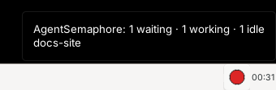
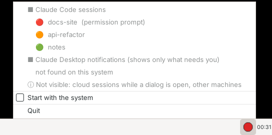

<p align="center">
  &nbsp;
  &nbsp;
  
</p>

<h1 align="center">AgentSemaphore</h1>

<p align="center">
  <b>One dot next to your clock that tells you which AI agent needs you.</b><br>
  Stop watching agent windows. Turn the notification noise off. Look at the dot.
</p>

<p align="center">
  <a href="https://github.com/LuisPuertollano/AgentSemaphore/actions/workflows/ci.yml"></a>
  
  
  
  
</p>

> [!WARNING]
> **Pre-alpha — testing stage.** Things will break and formats will change. So far it has been tried on
> only a handful of machines, so please do not rely on it yet.
> **If you try it, you are warmly invited to help:** report what you see on your system, share findings about
> agents' state files or notifications, or send a pull request. See [CONTRIBUTING.md](CONTRIBUTING.md).

### 🧪 Testers wanted

Especially on **macOS**, **Linux desktops** (GNOME, KDE, …) and with **GitHub Copilot CLI**, **OpenAI Codex CLI**
or **Gemini CLI**: those are tested only in CI so far. Install it ([below](#install)), use your agents as usual for
a while, and fill in a short [test report](https://github.com/LuisPuertollano/AgentSemaphore/issues/new?template=test-report.yml).
What to install, what to look at and what is known for the current release: **[docs/TESTING.md](docs/TESTING.md)**.
"All fine" is a useful report too. Website: https://luispuertollano.github.io/AgentSemaphore/

<p align="center">
  
</p>

### Real screenshots

The real program on a Linux desktop panel (XFCE), with three example Claude Code sessions. The menu
groups the sessions per source and says why one is waiting:

<p align="center">
  &nbsp;&nbsp;
  <br>
  
</p>

They are made by `tools/screenshots/linux.sh` on a virtual display. Windows and macOS screenshots from testers
are welcome.

## The four colours

| | Meaning |
|---|---|
|  **Red** | An agent is blocked **waiting for you**: a question, a permission, a plan to approve |
|  **Grey** | **Unknown.** A source could not be read, so a red might be hidden. It never pretends to be green |
|  **Orange** | An agent is **working** and does not need you |
|  **Green** | **All quiet.** Nothing is waiting for you |

The worst state across all sessions wins. Hover for a summary, click for the list of sessions.

## How it works

<p align="center">
  
</p>

- **Read-only.** For Claude it reads what Claude already writes: no hooks, no settings changed. For Copilot,
  Codex and Gemini CLI it can register an observer hook, only when you ask for it ([docs/AGENTS.md](docs/AGENTS.md)).
- **Local and private.** No accounts, no servers, no telemetry. Nothing leaves your machine.
- **Fails soft.** If a format changes upstream, the dot turns grey and the tooltip says which source; it never shows a wrong green.

## What it can see — and what it cannot (yet)

| | Seen? | How |
|---|---|---|
| Claude Code, CLI and Desktop **Code** tab, on this machine | ✅ red / orange / green, live | Claude Code's own session files |
| Claude **chat, Cowork, scheduled tasks** (Claude Desktop) | 🔴 only when they need you | Desktop's notifications (Windows) |
| **GitHub Copilot CLI, OpenAI Codex CLI, Gemini CLI** (optional hooks) | 🧪 red / orange / green, from their hook events; not yet tested with the real CLIs | `agentsemaphore hooks install …` ([details](docs/AGENTS.md)) |
| Claude Code **in the cloud** or **on another machine over SSH** | 🔴 when a turn ends and needs you (silent progress summaries are ignored) | Desktop's notifications (Windows) |
| …the same, while it asks for a permission mid-turn | 🔴 | Desktop's notifications (Windows) |
| …the same, while a direct question is open mid-turn | ❌ not yet | no local signal ([#22](https://github.com/LuisPuertollano/AgentSemaphore/issues/22), [#24](https://github.com/LuisPuertollano/AgentSemaphore/issues/24)) |
| A session that ends its turn with a question in plain text | 🟢 shows idle | known gap ([#20](https://github.com/LuisPuertollano/AgentSemaphore/issues/20)) |
| Other agents | ⏳ planned, ideas welcome | [Phase 3](https://github.com/LuisPuertollano/AgentSemaphore/issues/4) |

**Optional: your Claude plan usage in the menu** (5-hour and weekly windows, from Claude Code's own status line):
`agentsemaphore usage install claude`. It also adds two Claude Code hooks next to yours, so the menu says
"limit reached" when a usage limit stops Claude Code. Your own status line and hooks keep working, and
`usage uninstall claude` puts everything back. It never changes the dot. Details: [docs/USAGE.md](docs/USAGE.md).

Everything measured so far, including what is broken upstream, is in [docs/FINDINGS.md](docs/FINDINGS.md).

## Languages

The tray speaks **English, Español, Deutsch, Français, Italiano, 中文 and हिन्दी**. By default it uses your
system language. Better translations are very welcome: see [`internal/i18n/locales`](internal/i18n/locales).

## Install

### Windows (x64 and ARM64)

Per user, no admin rights, PowerShell 7. You get a clean uninstall and an optional "silence Claude's
pop-ups but keep the dot working". From a clone of this repo:

```powershell
pwsh -File install/windows/install.ps1 -FromRelease -Autostart -WhatIf   # see every change first
pwsh -File install/windows/install.ps1 -FromRelease -Autostart
```

This downloads the newest release for your machine (pre-releases included) and checks its SHA-256: one small executable, nothing else to install. Details,
the PowerShell prototype and the uninstaller: [install/windows](install/windows/README.md). If the dot hides
behind the **^** arrow next to the clock, drag it onto the taskbar.

**Or with [Scoop](https://scoop.sh)** (no clone needed; replace the version with the
[newest release](https://github.com/LuisPuertollano/AgentSemaphore/releases)):

```powershell
scoop install https://github.com/LuisPuertollano/AgentSemaphore/releases/download/v0.1.0-alpha.6/agentsemaphore.json
```

It adds AgentSemaphore to the Start menu and an `agentsemaphore` command (the console build) to your PATH.
Tick "Start with the system" in its menu to start it at sign-in.

### Linux and macOS (in progress)

The same Go core runs on Linux x64/ARM64 and macOS and reads Claude Code sessions. One line, no sudo:

```sh
curl -fsSL https://raw.githubusercontent.com/LuisPuertollano/AgentSemaphore/main/install/unix/install.sh | bash -s -- --autostart
```

It downloads the newest release for your machine, checks its SHA-256 and installs it in `~/.local/bin`.
Options, uninstall and the GNOME/macOS notes: [install/unix](install/unix/README.md). Every pull request runs
end-to-end tests on Linux x64, Linux ARM64 and macOS (Apple silicon and Intel), but nobody on the team uses these systems
daily yet: if you do, a quick test report is very welcome.

## Roadmap

1. ✅ Harden the Windows prototype
2. 🚧 Cross-platform core: ✅ Windows · 🚧 Linux and macOS (installer and CI tests done; real-desktop reports wanted)
3. 🚧 More agents: Copilot CLI, Codex CLI and Gemini CLI through their hooks (built and CI-tested, real-CLI reports wanted)
4. 🚧 Optional view of your subscription usage, from local data only: ✅ Claude Code (opt-in)
5. ⏳ Public release with a landing page

Live tracking: [docs/ROADMAP.md](docs/ROADMAP.md) and the [issues](https://github.com/LuisPuertollano/AgentSemaphore/issues).

## Contributing

Testing on your own machine is one of the most useful things you can do right now. See
[CONTRIBUTING.md](CONTRIBUTING.md).

## License

[MIT](LICENSE). Free forever, no telemetry, no accounts.
